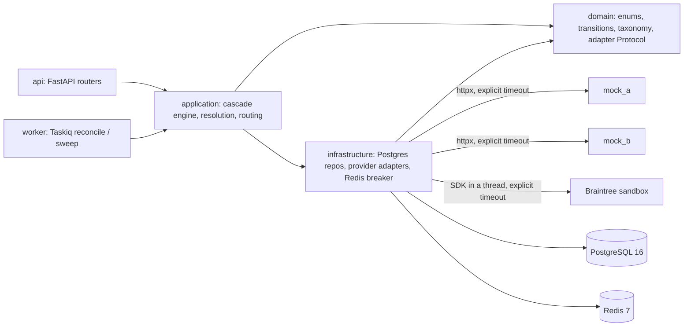
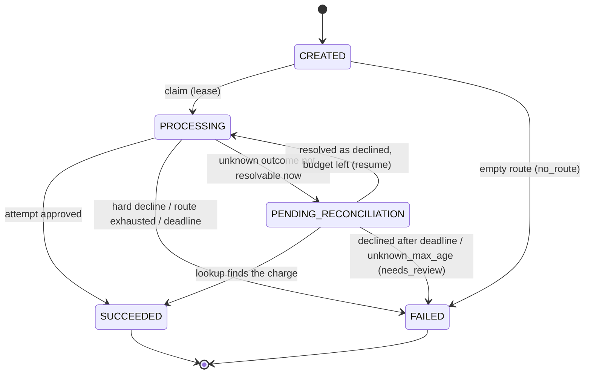
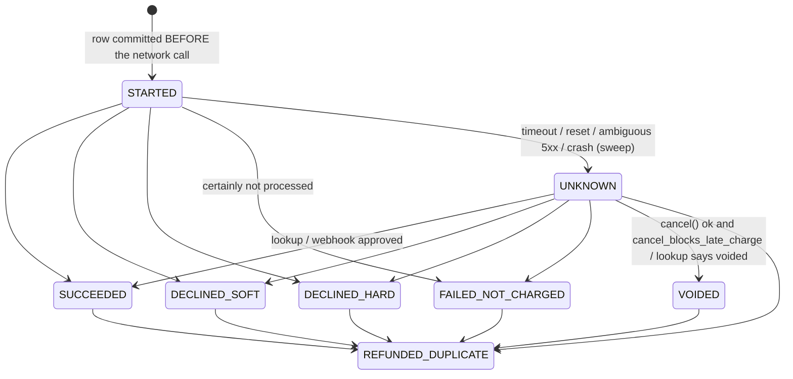

# DESIGN

Payment cascading service: one customer payment is tried against an ordered list of
providers; on a "someone else could approve this" failure the next one is tried. The
hard requirement is **at most one successful charge per payment**, including when a
provider's outcome is unknown.

## Layers

`domain` imports nothing from SQLAlchemy / httpx / FastAPI / Redis / Taskiq
(enforced by `tests/unit/test_layering.py`).

## Payment state machine

`CREATED -> FAILED`: an empty route (every provider disabled or its breaker open) fails the
payment before it is ever claimed.

Taking over a `PROCESSING` payment whose lease expired is **not** a status change: it is
the conditional `UPDATE ... WHERE lease_until < now()` claim. The claim
also writes a fresh `lease_owner` token; every later engine write checks (and renews) it
in the same short transaction, so a worker that lost its claim cannot write anything.
In `PENDING_RECONCILIATION` the `lease_until` column means "not before": the next time
reconciliation may claim the payment (backoff).

## Attempt state machine

`* -> REFUNDED_DUPLICATE` is the late-success path: the provider reports a charge
for an attempt we had already settled (or for a payment that is already terminal), we
cancelled that charge. It deliberately does not go through `SUCCEEDED`, so the partial
unique index "one SUCCEEDED attempt per payment" never gets in the way. A late success
on a declined/voided attempt never turns it into `SUCCEEDED`.

## One transition function

`cascade.domain.transitions.transition_payment / transition_attempt(current, target)`
return a `Transition` with `kind`:

| kind | meaning | engine | webhook / polling |
|---|---|---|---|
| `APPLIED` | edge exists in the graph | persist | persist |
| `DUPLICATE` | `current == target` | — (`require()` raises: a bug) | no-op, 200 |
| `REJECTED` | no such edge (e.g. stale event on a final attempt) | `require()` raises | no-op, log, 200 |

The function is pure; the repository calls it before every conditional
`UPDATE ... SET status=:target WHERE id=:id AND status=:current`, so two writers racing on
the same row cannot both apply a transition.

## Engine loop

The engine never decides from what it "just did"; each iteration re-reads the payment and
its attempts and looks at the **last attempt**:

| last attempt | action |
|---|---|
| none / money-free (`DECLINED_SOFT`, `FAILED_NOT_CHARGED`, `VOIDED`) | budget, route and `max_attempts` left? write-ahead next attempt, `charge()`, report to breaker, persist; else `FAILED` with the last reason |
| `SUCCEEDED` | done (payment was settled in the same transaction) |
| `DECLINED_HARD` | `FAILED`, stop |
| `STARTED` | previous worker crashed mid-call (or our write was lost): `UNKNOWN` |
| `UNKNOWN` | lookup ×N → cancel (if it blocks late charges) → else `PENDING_RECONCILIATION` + enqueue reconcile |

A webhook, a crashed predecessor or a lost write therefore all go through the same path.
Reconciliation (`PENDING_RECONCILIATION`) does one lookup per round; resolved → back into
the same loop (resume cascade if the deadline allows); still unknown → park again with
backoff; older than `unknown_max_age_s` → best-effort cancel, `FAILED`, `needs_review`.
The periodic sweep (inside the worker) picks up expired `PROCESSING` leases, due
`PENDING_RECONCILIATION` payments and `CREATED` payments older than the lease.

## Webhooks

Signature (HMAC-SHA256 of the raw body, `X-Signature`) → insert into `webhook_events`
(an already *processed* `(provider, event_id)` → 200, no-op) → apply → set
`processed_at`. A row without `processed_at` (apply failed, or the process died in between)
is applied again on redelivery; applying is idempotent. A **success** event is only a
trigger: the handler calls `lookup()` and applies the provider's *current* state through the
same transitions as polling (a webhook can be stale — e.g. sent before our own cancel voided
the charge). Lookup unavailable → defer to reconciliation. Success for an attempt that is
already settled, or a payment that is already terminal → late-success handling: cancel →
`REFUNDED_DUPLICATE`, or `needs_review` if the cancel fails. If applying fails, 500 is
returned and the provider redelivers.

The engine closes the mirror-image gap: if the provider answers APPROVED but the attempt was
already moved (a decline webhook raced the response), the engine cancels that charge before
it may try the next provider, or stops the cascade with `needs_review` if the cancel fails.

Braintree sends no webhooks for card sales; its attempts are reconciled by lookup only.

## Lookup extension

`LookupResult` has one value beyond APPROVED / DECLINED / NOT_FOUND / UNKNOWN: `VOIDED` (the reference existed and was
voided, e.g. our earlier cancel went through but its response was lost). It maps to
attempt `VOIDED` — holds no money, cannot be charged.

## Decline taxonomy

`cascade.domain.taxonomy`: `NormalizedReason` → `DeclineClass` in one table
(`DECLINE_CLASS`). Adapters map raw provider codes to a `NormalizedReason` via
`map_raw_code`; an unknown code becomes `UNMAPPED` (hard) with a warning log.
`ChargeResult.declined(reason)` derives SOFT/HARD from the table, and `ChargeResult`
refuses a soft/hard label that contradicts it, so an adapter cannot override the taxonomy.

## Storage-level invariants (migrations `0001`–`0003`)

* `payments.idempotency_key` UNIQUE — idempotent creation.
* `attempts (payment_id, seq)` UNIQUE — no two writers create the same attempt slot.
* partial UNIQUE `attempts(payment_id) WHERE status = 'SUCCEEDED'` — the database itself
  refuses a second successful attempt row. (`REFUNDED_DUPLICATE` is outside the predicate.)
* `webhook_events (provider, event_id)` UNIQUE — duplicate deliveries of a processed event
  are no-ops.
* `amount_minor > 0` (bigint, minor units), `currency ~ '^[A-Z]{3}$'`.
