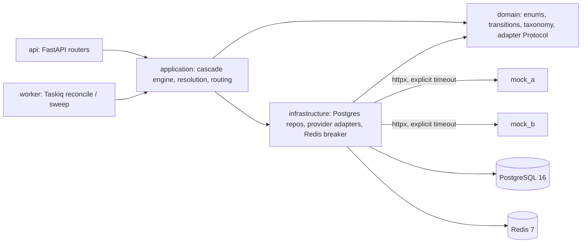
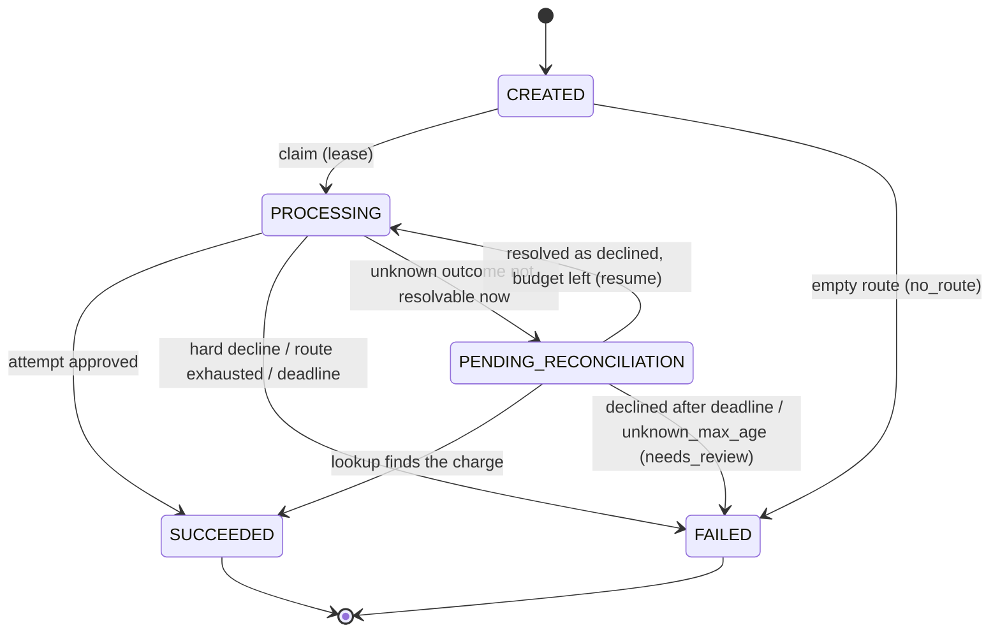
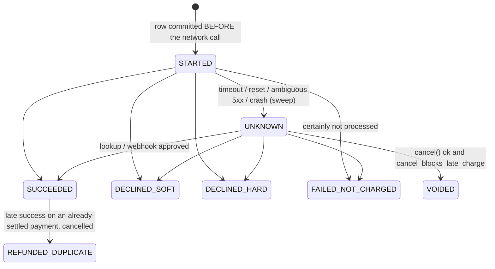

# DESIGN (M1)

Payment cascading service: one customer payment is tried against an ordered list of
providers; on a "someone else could approve this" failure the next one is tried. The
hard requirement is **at most one successful charge per payment**, including when a
provider's outcome is unknown.

## Layers

`domain` imports nothing from SQLAlchemy / httpx / FastAPI / Redis / Taskiq
(enforced by `tests/unit/test_layering.py`).

## Payment state machine

`CREATED -> FAILED` is not drawn in the spec's diagram but is required by 8.1 step 2
(empty route fails before the payment is ever claimed). Recorded in `NOTES.md`.

Taking over a `PROCESSING` payment whose lease expired is **not** a status change: it is
the conditional `UPDATE ... WHERE lease_until < now()` claim from 8.1 step 3.

## Attempt state machine

## One transition function

`cascade.domain.transitions.transition_payment / transition_attempt(current, target)`
return a `Transition` with `kind`:

| kind | meaning | engine | webhook / polling |
|---|---|---|---|
| `APPLIED` | edge exists in the graph | persist | persist |
| `DUPLICATE` | `current == target` | — (`require()` raises: a bug) | no-op, 200 |
| `REJECTED` | no such edge (e.g. stale event on a final attempt) | `require()` raises | no-op, log, 200 |

The function is pure; persistence (M2+) will be a conditional
`UPDATE ... SET status=:target WHERE id=:id AND status=:current`, so two writers racing on
the same row cannot both apply a transition.

## Decline taxonomy

`cascade.domain.taxonomy`: `NormalizedReason` → `DeclineClass` in one table
(`DECLINE_CLASS`). Adapters map raw provider codes to a `NormalizedReason` via
`map_raw_code`; an unknown code becomes `UNMAPPED` (hard) with a warning log.
`ChargeResult.declined(reason)` derives SOFT/HARD from the table, and `ChargeResult`
refuses a soft/hard label that contradicts it, so an adapter cannot override the taxonomy.

## Storage-level invariants (migration `0001`)

* `payments.idempotency_key` UNIQUE — idempotent creation.
* `attempts (payment_id, seq)` UNIQUE — no two writers create the same attempt slot.
* partial UNIQUE `attempts(payment_id) WHERE status = 'SUCCEEDED'` — the database itself
  refuses a second successful attempt row. (`REFUNDED_DUPLICATE` is outside the predicate.)
* `webhook_events (provider, event_id)` UNIQUE — duplicate deliveries are no-ops.
* `amount_minor > 0` (bigint, minor units), `currency ~ '^[A-Z]{3}$'`.
