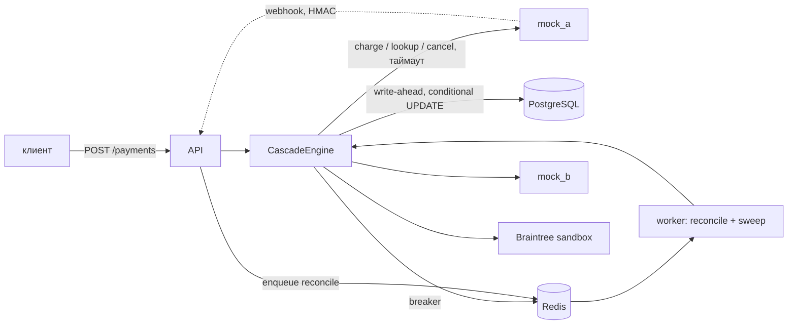

# Payment Cascading Service

[](https://github.com/Bucha11/test-payments-system/actions/workflows/ci.yml)

Сервис каскадных платежей: один платёж пробуется у упорядоченного списка провайдеров;
если провайдер отказал так, что другой мог бы одобрить, — пробуем следующего. Главное
свойство: **не более одного успешного списания на платёж**, в том числе когда исход
вызова неизвестен (таймаут, обрыв соединения, падение воркера посреди вызова).

## Запуск

```bash
make up     # api, worker, postgres, redis, mock_a, mock_b; миграции применяются при старте api
make test   # unit + integration + property-тесты (Postgres/Redis из compose)
make demo   # сценарии S1–S10 и BT1–BT3 против поднятого стека, затем /stats и /providers
```

Нужны Docker (compose v2) и [uv](https://docs.astral.sh/uv/); порты 5432, 6379, 8000, 8101,
8102 должны быть свободны. Провайдеры: два mock-провайдера и
[Braintree sandbox](#braintree-sandbox) — для него нужны ключи песочницы в `.env`, без них
сервис работает только на mock'ах. API — `http://localhost:8000`
(`POST /payments` с заголовком `Idempotency-Key`, `GET /payments/{id}`,
`POST /webhooks/{provider}`, `GET /stats`, `GET /providers`).

## Как пользоваться

### Создать платёж

```bash
curl -s -X POST http://localhost:8000/payments \
  -H 'Content-Type: application/json' \
  -H 'Idempotency-Key: order-42' \
  -d '{"amount_minor": 1999, "currency": "USD",
       "payment_method": {"token": "tok_visa", "bin": "424242", "country": "DE"}}'
```

- `amount_minor` — целое число в минимальных единицах (центы); дробные числа отклоняются (422).
- `currency` — ISO-код из 3 заглавных букв; `bin` (6–8 цифр) и `country` (2 буквы) опциональны
  и нужны только для маршрутизации.
- `token` — непрозрачный токен платёжного метода; номер карты сервис не принимает и не хранит.
- `Idempotency-Key` обязателен (400 без него). Повтор с тем же ключом и тем же телом
  возвращает текущее состояние того же платежа без повторной обработки; тот же ключ с
  другим телом — 422.

Ответ: **201**, если платёж в конечном статусе (`SUCCEEDED`/`FAILED`), **202**, если он ещё
в работе (`PENDING_RECONCILIATION` или повтор запроса, который пока обрабатывается).

```json
{
  "id": "…", "status": "SUCCEEDED", "amount_minor": 1999, "currency": "USD",
  "route": ["mock_a", "mock_b"], "failure_reason": null, "needs_review": false,
  "attempts": [
    {"seq": 1, "provider": "mock_a", "status": "DECLINED_SOFT", "reason": "do_not_honor", "duration_ms": 8},
    {"seq": 2, "provider": "mock_b", "status": "SUCCEEDED", "reason": null, "duration_ms": 11}
  ]
}
```

Токен в ответах и логах не появляется никогда.

### Остальные эндпоинты

| метод | путь | что делает |
|---|---|---|
| `GET` | `/payments/{id}` | состояние платежа со всеми попытками (201/202, как выше) |
| `POST` | `/webhooks/{provider}` | уведомление провайдера; подпись HMAC-SHA256 тела в `X-Signature`; дубликаты по `event_id` — no-op |
| `GET` | `/stats?window_min=60` | агрегаты за окно: по провайдерам (попытки, одобрения, soft/hard, сбои, approval rate, p50/p95) и общие (успехи, успехи с первой попытки, `cascade_saved`, `cascade_save_rate`, на сверке, `needs_review`) |
| `GET` | `/providers` | состояние breaker'а по каждому провайдеру: `CLOSED/OPEN/HALF_OPEN`, подряд идущие сбои, секунд до half-open |
| `GET` | `/health` | liveness |

### Конфигурация

`config/routing.yaml` проверяется Pydantic при старте; ошибка в конфиге — сервис не
запускается.

- `cascade`: `max_attempts`, `budget_s` (бюджет времени на каскад), `lease_s` (аренда
  обработки), `lookup_retries`, `unknown_max_age_s` (после этого неизвестный исход →
  `FAILED` + `needs_review`); дополнительно `lookup_backoff_s`,
  `reconcile_backoff_min_s/max_s`, `sweep_interval_s`.
- `providers`: тип (`mock` / `braintree`), `base_url`, `enabled`, `timeout_s`,
  `failure_threshold`, `cooldown_s`; опционально `cancel_blocks_late_charge`, `currencies`
  (какие валюты аккаунт провайдера умеет проводить), `merchant_account_id` (Braintree).
  Конфиг отклоняется, если одна попытка (`timeout_s × (lookup_retries + 2)`) может
  длиться дольше аренды `lease_s`.
- `routes`: правила по порядку, срабатывает первое подходящее. Условия `match`: `currency`,
  `country`, `amount_minor_gte`, `amount_minor_lt`, `bin_prefix`. Последнее правило —
  `default: true`. Элемент маршрута — имя провайдера или группа `{split: {mock_a: 70,
  mock_b: 30}}`: первый провайдер выбирается пропорционально весу, остальные идут
  запасными; порядок детерминирован по id платежа.

Переменные окружения (`.env`, шаблон — `.env.example`): `DATABASE_URL`, `REDIS_URL`,
`ROUTING_CONFIG`, `WEBHOOK_SECRET`, `LOG_LEVEL`, `BRAINTREE_ENVIRONMENT`,
`BRAINTREE_MERCHANT_ID`, `BRAINTREE_PUBLIC_KEY`, `BRAINTREE_PRIVATE_KEY`.

### Mock-провайдер

Одно приложение (`src/mock_provider`), два контейнера: `mock_a` на `localhost:8101`,
`mock_b` на `localhost:8102`. Состояние в памяти.

- `POST /_admin/script {"steps": [...]}` — поведение следующих списаний по очереди:
  `approve`, `soft_decline:<code>`, `hard_decline:<code>`, `error_500`, `timeout` (зависает,
  не списывает), `timeout_charged` (списывает и зависает), `late_charge:<сек>` (зависает,
  списывает через N секунд, если не отменён). Пустая очередь — `approve`.
- `POST /_admin/flags` — `lookup_down`, `cancel_down`, `cancel_blocks_late_charge`,
  `webhooks: off|once|duplicate`.
- `GET /_admin/ledger` — что реально списано (`charged`/`voided`); по нему тесты и демо
  проверяют инвариант.
- `GET /_admin/calls`, `GET /_admin/webhooks`, `POST /_admin/reset`.

Пример: `curl -X POST localhost:8101/_admin/script -d '{"steps":["soft_decline:do_not_honor"]}' -H 'Content-Type: application/json'`.

### Braintree sandbox

Настоящий тестовый провайдер (`src/cascade/infrastructure/providers/braintree.py`,
официальный SDK). Ключи берутся в панели песочницы (Settings → API) и кладутся в `.env`:
`BRAINTREE_MERCHANT_ID`, `BRAINTREE_PUBLIC_KEY`, `BRAINTREE_PRIVATE_KEY`. Без них адаптер не
создаётся и Braintree не попадает в маршруты.

- Маршрут: `USD` + `country: US` → `[braintree, mock_a]` (аккаунт песочницы проводит
  только USD; другая валюта — soft-отказ без сетевого вызова).
- Исход выбирается тестовой суммой: `2000.00` → отказ 2000 Do Not Honor (soft, каскад на
  mock_a), `2001.00` → 2001 Insufficient Funds (hard, стоп), `3000.00` → «processor network
  unavailable» (soft); остальные суммы одобряются.
- `charge` = `transaction.sale` с `order_id` = id попытки; `lookup` = поиск по `order_id`;
  `cancel` = `void` до проведения расчёта и `refund` после.
- У Braintree нет ключа идемпотентности и нет вебхуков на обычные списания, поэтому попытка
  отправляется один раз, а неизвестный исход выясняется только через `lookup`. `cancel` не
  останавливает запрос, который ещё в пути, поэтому `cancel_blocks_late_charge: false`:
  если исход не выяснен, платёж уходит на сверку, а не к следующему провайдеру.
- Токен: `fake-…` передаётся как nonce песочницы, `bt_<token>` — как сохранённый в Braintree
  метод оплаты; любой другой токен в песочнице списывается тестовой картой, чтобы один
  платёж мог пройти каскадом и через mock, и через Braintree.

```bash
curl -s -X POST http://localhost:8000/payments -H 'Content-Type: application/json' \
  -H "Idempotency-Key: bt-$RANDOM" \
  -d '{"amount_minor": 200000, "currency": "USD", "payment_method": {"token": "tok_visa", "country": "US"}}'
# -> braintree DECLINED_SOFT (do_not_honor), mock_a SUCCEEDED
```

### Команды

| команда | что делает |
|---|---|
| `make up` / `make down` | поднять стек (с пересборкой) / остановить и удалить данные |
| `make logs` | логи api и worker (JSON) |
| `make test` | все тесты против Postgres/Redis из compose (отдельная БД `cascade_test`) |
| `make test-unit` | только unit-тесты, без Docker |
| `make lint`, `make typecheck` | ruff; mypy strict для `domain` и `application` |
| `make demo` / `make demo-save` | демо-прогон / то же с записью в `docs/demo-output.txt` |

## Архитектура



Модульный монолит: `domain` (статусы, единая функция переходов, таксономия отказов,
контракт адаптера — без I/O-импортов, это проверяется тестом), `application` (движок,
маршрутизация, use cases), `infrastructure` (Postgres, Redis, адаптеры, Taskiq), `api`.
Диаграммы обоих автоматов состояний — в [DESIGN.md](DESIGN.md).

Платёж: `CREATED → PROCESSING → SUCCEEDED | FAILED | PENDING_RECONCILIATION`,
`PENDING_RECONCILIATION → PROCESSING | SUCCEEDED | FAILED`. Попытка:
`STARTED → SUCCEEDED | DECLINED_SOFT | DECLINED_HARD | FAILED_NOT_CHARGED | UNKNOWN`,
`UNKNOWN → … | VOIDED`, любое «закрытое» состояние → `REFUNDED_DUPLICATE` (поздний успех).

## Структура проекта

```
src/cascade/
  domain/          статусы, функция переходов, таксономия отказов, контракт адаптера (без I/O)
  application/     движок каскада, маршрутизация, конфиг, создание платежа, обработка вебхуков
  infrastructure/  Postgres-репозиторий, Redis-breaker, адаптеры mock и Braintree, задачи Taskiq, сборка зависимостей
  api/             FastAPI: роуты и схемы
src/mock_provider/ mock-провайдер
migrations/        Alembic (0001 — схема, 0002 — lease_owner, 0003 — webhook_events.processed_at)
config/routing.yaml
scripts/demo.py
tests/unit, tests/integration
```

## Тесты

- **Unit:** каждый легальный и нелегальный переход обоих автоматов, таксономия, контракт
  адаптера и классификация транспортных ошибок (таймаут, обрыв, 5xx, 409…), маршрутизация
  и валидация конфига, отсутствие I/O-импортов в домене.
- **Интеграционные:** настоящий движок и API, mock-провайдеры в том же процессе (httpx ASGI),
  настоящие Postgres и Redis. После каждого сценария проверяется инвариант ledger: у
  `SUCCEEDED` ровно одно списание, у остальных — ноль.

| # | сценарий | ожидание |
|---|---|---|
| S1 | A одобряет | `SUCCEEDED` на A, 1 попытка |
| S2 | A soft decline, B одобряет | `SUCCEEDED` на B |
| S3 | A hard decline | `FAILED`, B не вызывался |
| S4 | A отвечает 500 три раза | breaker открыт, дальше только B; после cooldown одна проба на A |
| S5 | A списал, но ответ потерян по таймауту | lookup находит списание, B не вызывался |
| S6 | A списал бы через 5 с | отмена с tombstone, `SUCCEEDED` на B, у A списания нет |
| S7 | A списал + lookup и cancel недоступны | 202 `PENDING_RECONCILIATION`, B не вызывался; после восстановления воркер доводит до `SUCCEEDED` на A |
| S8 | 10 параллельных запросов с одним ключом | один платёж, одно списание |
| S9 | дубль вебхука; поздний успех A после успеха на B | дубль — no-op; позднее списание отменено, `REFUNDED_DUPLICATE` |
| S10 | A и B soft decline | `FAILED`, маршрут исчерпан |
| S11 | процесс падает после записи попытки, A успел списать | sweep после истечения аренды находит списание, второго нет |
| S12 | EUR+DE; сумма ≥ 50000 | маршруты по `routing.yaml` |
| S13 | S1, S2, S3, S10 → `/stats` | 4 платежа, 2 успеха, `cascade_save_rate` 0.5 |
| S14 | 1000 разворотов split 70/30 | mock_a первый в 70% ± 5%, порядок детерминирован |
| — | вебхук об отказе пришёл раньше ответа APPROVED | списание отменено, `REFUNDED_DUPLICATE`, затем B; если отмена не прошла — `FAILED` + `needs_review`, B не вызывался |
| — | вебхук получен, но процесс упал до обработки | повторная доставка обрабатывается, а не отбрасывается как дубль |
| BT1 | Braintree sandbox одобряет | `SUCCEEDED` на Braintree, mock_a не вызывался |
| BT2 | Braintree: отказ 2000 (soft) | каскад на mock_a, ровно одно списание |
| BT3 | Braintree: отказ 2001 (hard) | `FAILED`, mock_a не вызывался |

Тесты Braintree: unit-тесты адаптера на фейковом шлюзе (классификация ответов и ошибок,
lookup, void/refund) идут всегда; тесты против настоящей песочницы
(`tests/integration/test_braintree_sandbox.py`) пропускаются, если ключей нет.

### CI

GitHub Actions (`.github/workflows/ci.yml`) на каждый push и pull request:

- **lint-typecheck** — `make lint` (ruff) и `make typecheck` (mypy strict для `domain` и
  `application`);
- **test** — `make test`: все тесты против Postgres и Redis, поднятых через docker compose
  прямо на раннере.

Тесты против Braintree sandbox в CI тоже выполняются: ключи песочницы хранятся в
**Repository secrets** (Settings → Secrets and variables → Actions) под именами
`BRAINTREE_MERCHANT_ID`, `BRAINTREE_PUBLIC_KEY`, `BRAINTREE_PRIVATE_KEY` и передаются в
шаг `make test` через `env:`. В репозитории ключей нет. Где секретов нет (форк, pull request
из форка), эти тесты пропускаются, а остальные идут как обычно. Чтобы включить их в своём
форке, добавьте три секрета с ключами своей песочницы.

- **Property-тест (Hypothesis):** случайные скрипты и флаги для обоих провайдеров, платёж
  доводится до конечного статуса. Проверяется: инвариант ledger, `SUCCEEDED` без списания
  невозможен, после hard decline нет новых попыток. Тест проверен мутацией: если движок
  перестаёт ждать выяснения неизвестного исхода, тест падает.

## Ключевые решения и компромиссы

**Write-ahead попытки.** Строка попытки `STARTED` коммитится *до* сетевого вызова, id
попытки — это reference/ключ идемпотентности у провайдера. Если процесс упал посреди
вызова, после истечения аренды sweep видит `STARTED`, считает исход неизвестным и
выясняет его у провайдера по тому же reference. Без этого «потерянное» списание было бы
невидимо.

**Политика неизвестного исхода.** Перейти к следующему провайдеру можно только когда
текущая попытка *доказуемо* не держит денег и не сможет списать их позже: `lookup` с
ретраями → `cancel` (только если отмена гарантирует, что reference больше не спишется) →
иначе `PENDING_RECONCILIATION` и ответ 202, следующий провайдер **не** пробуется. Цена —
конверсия: часть клиентов ждёт сверки вместо мгновенного успеха у второго провайдера.
Взамен двойное списание исключено конструкцией, а не «маловероятно». Страховка на случай,
если провайдер всё же списал позже (S9): вебхук об успехе по уже закрытой попытке →
`cancel` → `REFUNDED_DUPLICATE`, а если отмена не прошла — `needs_review`. Сам вебхук об
успехе — только сигнал: актуальное состояние берётся из `lookup()`, потому что событие
может быть устаревшим (отправлено до того, как наш `cancel` аннулировал списание). Этот
случай нашёл property-тест на Hypothesis.

**Soft/hard таксономия.** Один вопрос: «может ли другой провайдер/эквайер одобрить?».
Адаптеры только переводят сырые коды в нормализованную причину; класс выводится из
одной таблицы в домене, адаптер не может его переопределить. Незнакомый код → `unmapped`
→ hard: повтор неизвестного отказа у другого провайдера может нарушить правила
платёжных систем, поэтому безопаснее остановиться и дополнить маппинг.

**Breaker не считает отказы.** Decline — это здоровый провайдер, который ответил «нет».
Считаем только `FAILED_NOT_CHARGED` и `UNKNOWN`. Иначе волна «плохих» карт выключила бы
исправного провайдера. HALF_OPEN пропускает ровно одну пробу (`SET NX`).

**Аренда вместо блокировок.** Нельзя держать транзакцию или row lock во время сетевого
вызова. Платёж «захватывается» атомарным `UPDATE … WHERE lease_until < now()`, плюс
fencing-токен `lease_owner`: каждая запись движка проверяет и продлевает свою аренду в той
же короткой транзакции. Воркер, у которого аренду перехватили, не может ничего записать.
Все смены статусов — условные `UPDATE … WHERE status = :from` через одну доменную функцию,
поэтому вебхук, поллинг и движок не могут «перебить» друг друга, а дубликаты — no-op.
Последняя линия обороны — частичный уникальный индекс «один `SUCCEEDED` на платёж».

**Почему без распределённых транзакций.** У провайдера нет 2PC, а БД и провайдер — разные
системы. Вместо этого — идемпотентность по reference, write-ahead журнал попыток и сверка
(lookup/cancel/вебхуки). Это стандартная модель «at-least-once + идемпотентность».

## Что сознательно не сделано

UI, аутентификация и мульти-мерчант, 3-D Secure, публичные refunds/captures, хранение
карт (только токены), Kubernetes, Prometheus/Grafana (есть JSON-логи и `/stats`),
нагрузочные тесты, dunning (повторы через дни — другая задача), ML-роутинг.

## Известные ограничения

Что работает не идеально или упрощено. Решения и их обоснование — в [NOTES.md](NOTES.md).

**Деньги и сверка**
- **Позднее списание без вебхука не обнаруживается.** Если провайдер сообщил об отказе
  или подтвердил отмену, а потом всё-таки списал и не прислал вебхук, сервис об этом не
  узнает. Braintree вебхуков на списания не шлёт вовсе. В проде это закрывается сверкой с
  отчётами провайдера (settlement reports), здесь её нет.
- **`needs_review` требует ручной работы.** Если неизвестный исход не прояснился за
  `unknown_max_age_s` (по умолчанию 15 минут) или поздний успех не удалось отменить,
  платёж помечается `needs_review`. Деньги в таком случае могут быть списаны; инструментов
  для разбора (админ-API, очереди) нет.
- **Вебхук об успехе не применяется, пока недоступен lookup.** Это намеренно (событие
  может быть устаревшим), но разрешение платежа откладывается до восстановления lookup.
- **Плата за безопасность — конверсия.** При неизвестном исходе, который нельзя отменить,
  клиент получает 202 и ждёт сверки, а не успех у второго провайдера.

**Обработка**
- **Каскад выполняется синхронно внутри HTTP-запроса.** Ответ может занять бюджет
  (`budget_s`, 20 с) плюс lookup'ы и отмену. Клиент с коротким таймаутом может не дождаться
  ответа; тогда повтор с тем же `Idempotency-Key` вернёт текущее состояние.
- **Дедлайн не прерывает попытку в полёте.** Он проверяется перед стартом новой попытки,
  поэтому каскад может закончиться позже `deadline_at` на время таймаута провайдера.
- **Фоновая проверка (sweep) — в каждом процессе воркера.** Захват платежей атомарный,
  поэтому это безопасно, но при большом числе воркеров даёт лишние запросы к БД.
- **Разные источники времени.** Дедлайн считается по часам приложения, аренда — по
  `now()` базы. Сильный рассинхрон часов сказывается на точности таймингов (не на
  инварианте «одно списание»).

**Breaker и маршрутизация**
- **Пробу half-open резервирует построение маршрута.** Если такой провайдер стоит в
  маршруте не первым и платёж успел пройти раньше, проба пропадает до истечения ключа
  (= `cooldown_s`), и провайдер дольше остаётся выключенным.
- **Если Redis недоступен, breaker пропускает всех** (fail-open), чтобы не остановить
  приём платежей.
- **Нет лимитов объёма на MID**, нет учёта дневных/месячных капов; веса split работают
  только статистически.
- **Маршрут фиксируется при создании платежа.** Изменение `routing.yaml` во время
  обработки на уже созданные платежи не влияет.

**Хранение и эксплуатация**
- **Токен платёжного метода хранится в БД открытым текстом.** Это непрозрачный токен, а не
  номер карты, но шифрования на уровне поля нет.
- **Нет очистки:** ключи идемпотентности и `webhook_events` хранятся бессрочно.
- **`/stats` считается на лету** SQL-агрегатами; на больших объёмах нужны
  предагрегация или реплика.
- **Один общий секрет вебхуков** для всех провайдеров (`WEBHOOK_SECRET`); нет ротации.
- **Нет аутентификации и мульти-мерчанта:** любой, кто достучится до API, может создать
  платёж (сознательно вне рамок задания).

**Провайдеры**
- **Один токен на всех провайдеров.** В песочнице Braintree любой «чужой» токен списывается
  тестовой картой. В проде нужен vault или сетевые токены, чтобы одна карта клиента
  превращалась в токен каждого провайдера.
- **Braintree только USD** (так настроен аккаунт песочницы); мультивалютность — это
  отдельные merchant account'ы и `merchant_account_id` по валюте.
- **Mock-провайдер хранит всё в памяти:** перезапуск контейнера теряет его ledger.

## Заметки для high-risk мерчанта в проде

- **Падение провайдера/MID и закрытие аккаунта** — это событие маршрутизации: MID выводится
  из роутинга конфигом (`enabled: false`), breaker делает то же автоматически при сбоях.
- **Лимиты объёма на MID и балансировка** — веса в `split` плюс дневные/месячные
  капы на MID (здесь не реализованы; естественное место — фильтр при построении маршрута).
- **Роутинг по BIN/гео/валюте** — правила `match` (валюта, страна, сумма, префикс BIN).
- **Правила повторов платёжных систем** — некоторые коды отказа (например, «не повторять»
  у Visa/Mastercard) нельзя ретраить нигде и часто ограничено число повторов по карте —
  отсюда hard-по-умолчанию для неизвестных кодов и `max_attempts`.
- **3-D Secure ломает синхронный каскад** — после challenge у одного провайдера нельзя
  тихо уйти к другому; нужен асинхронный флоу с возвратом клиента.
- **Метрики** — конверсия каскада (`cascade_save_rate`), approval rate и латентность по
  провайдерам (`GET /stats`), очередь сверки и `needs_review` — основные алерты.

## Вывод реального прогона `make demo`

<details>
<summary>docs/demo-output.txt</summary>

```text

=== S1  A approves
payment d690029e-03bd-4f1b-9954-d51d8e149537: SUCCEEDED (HTTP 201); route=['mock_a', 'mock_b']
  seq  provider  status              reason                  duration
    1  mock_a    SUCCEEDED           -                          18 ms
  ledger: 1 charge(s), expected 1 -> OK

=== S5  A times out but charged -> lookup finds it, B never called
payment 0d8c3f82-07b8-47ba-bf5c-7a62ad336303: SUCCEEDED (HTTP 201); route=['mock_a', 'mock_b']
  seq  provider  status              reason                  duration
    1  mock_a    SUCCEEDED           -                        3004 ms
  ledger: 1 charge(s), expected 1 -> OK
  mock_b charge calls: 0

=== S2  A soft decline -> B approves
payment 446cda67-3927-4249-8a59-ebb89be60f01: SUCCEEDED (HTTP 201); route=['mock_a', 'mock_b']
  seq  provider  status              reason                  duration
    1  mock_a    DECLINED_SOFT       do_not_honor                6 ms
    2  mock_b    SUCCEEDED           -                           7 ms
  ledger: 1 charge(s), expected 1 -> OK

=== S6  A hangs, would charge after 5 s -> cancelled (tombstone), B approves
payment 2b2c6417-94c5-4cd6-8f93-548b6e524964: SUCCEEDED (HTTP 201); route=['mock_a', 'mock_b']
  seq  provider  status              reason                  duration
    1  mock_a    VOIDED              provider_unavailable     3004 ms
    2  mock_b    SUCCEEDED           -                           6 ms
  ledger: 1 charge(s), expected 1 -> OK
  after 6 s: mock_a charged entries for this payment = 0

=== S6  (re-check after 6 s)
payment 2b2c6417-94c5-4cd6-8f93-548b6e524964: SUCCEEDED; route=['mock_a', 'mock_b']
  seq  provider  status              reason                  duration
    1  mock_a    VOIDED              provider_unavailable     3004 ms
    2  mock_b    SUCCEEDED           -                           6 ms
  ledger: 1 charge(s), expected 1 -> OK

=== S3  A hard decline -> stop, B never called
payment b3b21e50-8263-4332-817c-84271dd7e62c: FAILED (HTTP 201), reason=insufficient_funds; route=['mock_a', 'mock_b']
  seq  provider  status              reason                  duration
    1  mock_a    DECLINED_HARD       insufficient_funds          8 ms
  ledger: 0 charge(s), expected 0 -> OK
  mock_b charge calls: 0

=== S7  A unknown + lookup/cancel down -> parked, B never called
payment 54f73824-53bb-49d4-aa75-ade7a4a91d14: PENDING_RECONCILIATION (HTTP 202); mock_b calls: 0
  outage over (flags cleared); waiting for the worker to reconcile...

=== S7  after reconciliation by the worker
payment 54f73824-53bb-49d4-aa75-ade7a4a91d14: SUCCEEDED; route=['mock_a', 'mock_b']
  seq  provider  status              reason                  duration
    1  mock_a    SUCCEEDED           -                        3003 ms
  ledger: 1 charge(s), expected 1 -> OK

=== S8  10 concurrent POSTs with one Idempotency-Key
  distinct payment ids: 1; HTTP codes: [201, 202, 202, 202, 202, 202, 202, 202, 202, 202]
  provider charge calls: 1

=== S8  resulting payment
payment 5f7d636d-6393-4755-99c5-0a21e80c0001: SUCCEEDED; route=['mock_a', 'mock_b']
  seq  provider  status              reason                  duration
    1  mock_a    SUCCEEDED           -                           8 ms
  ledger: 1 charge(s), expected 1 -> OK

=== S9a A approves, webhook delivered twice (duplicate is a no-op)
payment 7c08d55e-ee38-4d90-8d5a-373234159a5d: SUCCEEDED (HTTP 201); route=['mock_a', 'mock_b']
  seq  provider  status              reason                  duration
    1  mock_a    SUCCEEDED           -                           8 ms
  ledger: 1 charge(s), expected 1 -> OK
  webhooks delivered: 2; status still SUCCEEDED

=== S9b A's cancel does NOT block the late charge -> B approves meanwhile
payment 97683619-3b21-491f-b414-7a16a157b952: SUCCEEDED (HTTP 201); route=['mock_a', 'mock_b']
  seq  provider  status              reason                  duration
    1  mock_a    VOIDED              provider_unavailable     3655 ms
    2  mock_b    SUCCEEDED           -                          28 ms
  ledger: 1 charge(s), expected 1 -> OK
  waiting for A's late charge + its webhook...

=== S9b after late-success webhook: A cancelled -> REFUNDED_DUPLICATE
payment 97683619-3b21-491f-b414-7a16a157b952: SUCCEEDED; route=['mock_a', 'mock_b']
  seq  provider  status              reason                  duration
    1  mock_a    REFUNDED_DUPLICATE  provider_unavailable     3655 ms
    2  mock_b    SUCCEEDED           -                          28 ms
  ledger: 1 charge(s), expected 1 -> OK

=== S10 A and B soft decline -> FAILED, route exhausted
payment 76f9a357-a400-4021-aeb9-d020557ff3d3: FAILED (HTTP 201), reason=generic_decline; route=['mock_a', 'mock_b']
  seq  provider  status              reason                  duration
    1  mock_a    DECLINED_SOFT       do_not_honor              116 ms
    2  mock_b    DECLINED_SOFT       generic_decline            28 ms
  ledger: 0 charge(s), expected 0 -> OK

=== BT1 US card: Braintree sandbox approves
payment 663f45fa-df97-42d6-afd5-ead7a7f5b5b3: SUCCEEDED (HTTP 201); route=['braintree', 'mock_a']
  seq  provider  status              reason                  duration
    1  braintree SUCCEEDED           -                        1317 ms
  ledger: 1 charge(s), expected 1 -> OK

=== BT2 Braintree soft decline (2000 Do Not Honor) -> mock_a approves
payment bb7e8c61-78c9-40c1-9e83-498ec6d420c6: SUCCEEDED (HTTP 201); route=['braintree', 'mock_a']
  seq  provider  status              reason                  duration
    1  braintree DECLINED_SOFT       do_not_honor              861 ms
    2  mock_a    SUCCEEDED           -                           7 ms
  ledger: 1 charge(s), expected 1 -> OK

=== BT3 Braintree hard decline (2001 Insufficient Funds) -> stop, mock_a never called
payment b65ecd16-56f9-4f3a-b12e-eecd28b358af: FAILED (HTTP 201), reason=insufficient_funds; route=['braintree', 'mock_a']
  seq  provider  status              reason                  duration
    1  braintree DECLINED_HARD       insufficient_funds        985 ms
  ledger: 0 charge(s), expected 0 -> OK
  mock_a charge calls: 0

=== S4.1 A returns 500 (unknown -> lookup NOT_FOUND -> cancel) -> B
payment efe523f8-e49d-4610-9c8c-93a0293eeaae: SUCCEEDED (HTTP 201); route=['mock_a', 'mock_b']
  seq  provider  status              reason                  duration
    1  mock_a    VOIDED              provider_unavailable        6 ms
    2  mock_b    SUCCEEDED           -                           7 ms
  ledger: 1 charge(s), expected 1 -> OK

=== S4.2 A returns 500 (unknown -> lookup NOT_FOUND -> cancel) -> B
payment 5a7d30f4-3325-417b-a49b-dccb474ade3b: SUCCEEDED (HTTP 201); route=['mock_a', 'mock_b']
  seq  provider  status              reason                  duration
    1  mock_a    VOIDED              provider_unavailable        5 ms
    2  mock_b    SUCCEEDED           -                           8 ms
  ledger: 1 charge(s), expected 1 -> OK

=== S4.3 A returns 500 (unknown -> lookup NOT_FOUND -> cancel) -> B
payment c1215729-20f3-4ce2-b3b7-46450ed62cf3: SUCCEEDED (HTTP 201); route=['mock_a', 'mock_b']
  seq  provider  status              reason                  duration
    1  mock_a    VOIDED              provider_unavailable        8 ms
    2  mock_b    SUCCEEDED           -                           6 ms
  ledger: 1 charge(s), expected 1 -> OK

  /providers after 3 consecutive failures on A:
[
  {
    "name": "mock_a",
    "type": "mock",
    "enabled": true,
    "breaker_state": "OPEN",
    "consecutive_failures": 3,
    "seconds_until_half_open": 29.3
  },
  {
    "name": "mock_b",
    "type": "mock",
    "enabled": true,
    "breaker_state": "CLOSED",
    "consecutive_failures": 0,
    "seconds_until_half_open": null
  },
  {
    "name": "braintree",
    "type": "braintree",
    "enabled": true,
    "breaker_state": "CLOSED",
    "consecutive_failures": 0,
    "seconds_until_half_open": null
  }
]

=== S4.4 A's breaker is OPEN -> route is B only
payment 8d329688-6e32-4297-a058-6c900ebde2b0: SUCCEEDED (HTTP 201); route=['mock_b']
  seq  provider  status              reason                  duration
    1  mock_b    SUCCEEDED           -                           5 ms
  ledger: 1 charge(s), expected 1 -> OK
  waiting 31 s for A's cooldown...

=== S4.5 after cooldown: one half-open probe goes to A, succeeds, breaker closes
payment af44dca7-c742-4f2f-a09f-d65489223092: SUCCEEDED (HTTP 201); route=['mock_a', 'mock_b']
  seq  provider  status              reason                  duration
    1  mock_a    SUCCEEDED           -                           7 ms
  ledger: 1 charge(s), expected 1 -> OK

=== GET /stats?window_min=60
{
  "window_min": 60,
  "overall": {
    "payments": 55,
    "succeeded": 47,
    "failed": 8,
    "succeeded_first_attempt": 25,
    "cascade_saved": 22,
    "pending_reconciliation": 0,
    "needs_review": 0,
    "cascade_eligible": 25,
    "cascade_save_rate": 0.88
  },
  "providers": {
    "braintree": {
      "attempts": 6,
      "approved": 2,
      "soft_declines": 2,
      "hard_declines": 2,
      "failed_unknown": 0,
      "refunded_duplicates": 0,
      "p50_ms": 1040.8,
      "p95_ms": 1322.5,
      "approval_rate": 0.3333
    },
    "mock_a": {
      "attempts": 48,
      "approved": 22,
      "soft_declines": 6,
      "hard_declines": 3,
      "failed_unknown": 13,
      "refunded_duplicates": 4,
      "p50_ms": 9.3,
      "p95_ms": 3134.5,
      "approval_rate": 0.4583
    },
    "mock_b": {
      "attempts": 26,
      "approved": 23,
      "soft_declines": 3,
      "hard_declines": 0,
      "failed_unknown": 0,
      "refunded_duplicates": 0,
      "p50_ms": 8.9,
      "p95_ms": 202.5,
      "approval_rate": 0.8846
    }
  }
}

=== GET /providers
[
  {
    "name": "mock_a",
    "type": "mock",
    "enabled": true,
    "breaker_state": "CLOSED",
    "consecutive_failures": 0,
    "seconds_until_half_open": null
  },
  {
    "name": "mock_b",
    "type": "mock",
    "enabled": true,
    "breaker_state": "CLOSED",
    "consecutive_failures": 0,
    "seconds_until_half_open": null
  },
  {
    "name": "braintree",
    "type": "braintree",
    "enabled": true,
    "breaker_state": "CLOSED",
    "consecutive_failures": 0,
    "seconds_until_half_open": null
  }
]

ledger violations: 0 
```

</details>
