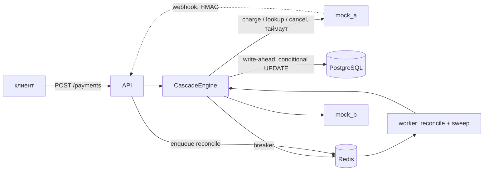

# Payment Cascading Service

[](https://github.com/Bucha11/test-payments-system/actions/workflows/ci.yml)

Сервис каскадных платежей: один платёж пробуется у упорядоченного списка провайдеров;
если провайдер отказал так, что другой мог бы одобрить, — пробуем следующего. Главное
свойство: **не более одного успешного списания на платёж**, в том числе когда исход
вызова неизвестен (таймаут, обрыв соединения, падение воркера посреди вызова).

## Запуск

```bash
make up     # api, worker, postgres, redis, mock_a, mock_b; миграции применяются при старте api
make test   # unit + integration + property-тесты (Postgres/Redis из compose)
make demo   # сценарии S1–S10 против поднятого стека, затем /stats и /providers
```

Нужны Docker (compose v2) и [uv](https://docs.astral.sh/uv/). API — `http://localhost:8000`
(`POST /payments` с заголовком `Idempotency-Key`, `GET /payments/{id}`,
`POST /webhooks/{provider}`, `GET /stats`, `GET /providers`).

## Архитектура



Модульный монолит: `domain` (статусы, единая функция переходов, таксономия отказов,
контракт адаптера — без I/O-импортов, это проверяется тестом), `application` (движок,
маршрутизация, use cases), `infrastructure` (Postgres, Redis, адаптеры, Taskiq), `api`.
Диаграммы обоих автоматов состояний — в [DESIGN.md](DESIGN.md).

Платёж: `CREATED → PROCESSING → SUCCEEDED | FAILED | PENDING_RECONCILIATION`,
`PENDING_RECONCILIATION → PROCESSING | SUCCEEDED | FAILED`. Попытка:
`STARTED → SUCCEEDED | DECLINED_SOFT | DECLINED_HARD | FAILED_NOT_CHARGED | UNKNOWN`,
`UNKNOWN → … | VOIDED`, любое «закрытое» состояние → `REFUNDED_DUPLICATE` (поздний успех).

## Ключевые решения и компромиссы

**Write-ahead попытки.** Строка попытки `STARTED` коммитится *до* сетевого вызова, id
попытки — это reference/ключ идемпотентности у провайдера. Если процесс упал посреди
вызова, после истечения аренды sweep видит `STARTED`, считает исход неизвестным и
выясняет его у провайдера по тому же reference. Без этого «потерянное» списание было бы
невидимо.

**Политика неизвестного исхода (8.2).** Перейти к следующему провайдеру можно только когда
текущая попытка *доказуемо* не держит денег и не сможет списать их позже: `lookup` с
ретраями → `cancel` (только если отмена гарантирует, что reference больше не спишется) →
иначе `PENDING_RECONCILIATION` и ответ 202, следующий провайдер **не** пробуется. Цена —
конверсия: часть клиентов ждёт сверки вместо мгновенного успеха у второго провайдера.
Взамен двойное списание исключено конструкцией, а не «маловероятно». Страховка на случай,
если провайдер всё же списал позже (S9): вебхук об успехе по уже закрытой попытке →
`cancel` → `REFUNDED_DUPLICATE`, а если отмена не прошла — `needs_review`. Сам вебхук об
успехе — только сигнал: актуальное состояние берётся из `lookup()`, потому что событие
может быть устаревшим (отправлено до того, как наш `cancel` аннулировал списание). Этот
случай нашёл property-тест на Hypothesis.

**Soft/hard таксономия.** Один вопрос: «может ли другой провайдер/эквайер одобрить?».
Адаптеры только переводят сырые коды в нормализованную причину; класс выводится из
одной таблицы в домене, адаптер не может его переопределить. Незнакомый код → `unmapped`
→ hard: повтор неизвестного отказа у другого провайдера может нарушить правила
платёжных систем, поэтому безопаснее остановиться и дополнить маппинг.

**Breaker не считает отказы.** Decline — это здоровый провайдер, который ответил «нет».
Считаем только `FAILED_NOT_CHARGED` и `UNKNOWN`. Иначе волна «плохих» карт выключила бы
исправного провайдера. HALF_OPEN пропускает ровно одну пробу (`SET NX`).

**Аренда вместо блокировок.** Нельзя держать транзакцию или row lock во время сетевого
вызова. Платёж «захватывается» атомарным `UPDATE … WHERE lease_until < now()`, плюс
fencing-токен `lease_owner`: каждая запись движка проверяет и продлевает свою аренду в той
же короткой транзакции. Воркер, у которого аренду перехватили, не может ничего записать.
Все смены статусов — условные `UPDATE … WHERE status = :from` через одну доменную функцию,
поэтому вебхук, поллинг и движок не могут «перебить» друг друга, а дубликаты — no-op.
Последняя линия обороны — частичный уникальный индекс «один `SUCCEEDED` на платёж».

**Почему без распределённых транзакций.** У провайдера нет 2PC, а БД и провайдер — разные
системы. Вместо этого — идемпотентность по reference, write-ahead журнал попыток и сверка
(lookup/cancel/вебхуки). Это стандартная модель «at-least-once + идемпотентность».

## Что сознательно не сделано

UI, аутентификация и мульти-мерчант, 3-D Secure, публичные refunds/captures, хранение
карт (только токены), Kubernetes, Prometheus/Grafana (есть JSON-логи и `/stats`),
нагрузочные тесты, dunning (повторы через дни — другая задача), ML-роутинг. Адаптер
Braintree (M7) не делался: нет sandbox-учётки; детали API нужно сверять с документацией
(см. [NOTES.md](NOTES.md)).

## Заметки для high-risk мерчанта в проде

- **Падение провайдера/MID и закрытие аккаунта** — это событие маршрутизации: MID выводится
  из роутинга конфигом (`enabled: false`), breaker делает то же автоматически при сбоях.
- **Лимиты объёма на MID и балансировка** — веса в `split` (8.7) плюс дневные/месячные
  капы на MID (здесь не реализованы; естественное место — фильтр при построении маршрута).
- **Роутинг по BIN/гео/валюте** — правила `match` (валюта, страна, сумма, префикс BIN).
- **Правила повторов платёжных систем** — некоторые коды отказа (например, «не повторять»
  у Visa/Mastercard) нельзя ретраить нигде и часто ограничено число повторов по карте —
  отсюда hard-по-умолчанию для неизвестных кодов и `max_attempts`.
- **3-D Secure ломает синхронный каскад** — после challenge у одного провайдера нельзя
  тихо уйти к другому; нужен асинхронный флоу с возвратом клиента.
- **Метрики** — конверсия каскада (`cascade_save_rate`), approval rate и латентность по
  провайдерам (`GET /stats`), очередь сверки и `needs_review` — основные алерты.

## Вывод реального прогона `make demo`

<details>
<summary>docs/demo-output.txt</summary>

```text

=== S1  A approves
payment 61cb1f46-2308-4d63-8462-043037c7c7bf: SUCCEEDED (HTTP 201); route=['mock_a', 'mock_b']
  seq  provider  status              reason                  duration
    1  mock_a    SUCCEEDED           -                          24 ms
  ledger: 1 charge(s), expected 1 -> OK

=== S5  A times out but charged -> lookup finds it, B never called
payment 15bd07f1-7578-4ee6-8436-feaf79d43bac: SUCCEEDED (HTTP 201); route=['mock_a', 'mock_b']
  seq  provider  status              reason                  duration
    1  mock_a    SUCCEEDED           -                        3009 ms
  ledger: 1 charge(s), expected 1 -> OK
  mock_b charge calls: 0

=== S2  A soft decline -> B approves
payment 086423b5-e0d5-407e-ab2d-f8338945d325: SUCCEEDED (HTTP 201); route=['mock_a', 'mock_b']
  seq  provider  status              reason                  duration
    1  mock_a    DECLINED_SOFT       do_not_honor                8 ms
    2  mock_b    SUCCEEDED           -                          11 ms
  ledger: 1 charge(s), expected 1 -> OK

=== S6  A hangs, would charge after 5 s -> cancelled (tombstone), B approves
payment 5f4e164a-df47-4418-8e7e-550c414dae7a: SUCCEEDED (HTTP 201); route=['mock_a', 'mock_b']
  seq  provider  status              reason                  duration
    1  mock_a    VOIDED              provider_unavailable     3007 ms
    2  mock_b    SUCCEEDED           -                           8 ms
  ledger: 1 charge(s), expected 1 -> OK
  after 6 s: mock_a charged entries for this payment = 0

=== S6  (re-check after 6 s)
payment 5f4e164a-df47-4418-8e7e-550c414dae7a: SUCCEEDED; route=['mock_a', 'mock_b']
  seq  provider  status              reason                  duration
    1  mock_a    VOIDED              provider_unavailable     3007 ms
    2  mock_b    SUCCEEDED           -                           8 ms
  ledger: 1 charge(s), expected 1 -> OK

=== S3  A hard decline -> stop, B never called
payment afc23df4-4f3c-4e0d-b5bd-647efdf8bf10: FAILED (HTTP 201), reason=insufficient_funds; route=['mock_a', 'mock_b']
  seq  provider  status              reason                  duration
    1  mock_a    DECLINED_HARD       insufficient_funds          9 ms
  ledger: 0 charge(s), expected 0 -> OK
  mock_b charge calls: 0

=== S7  A unknown + lookup/cancel down -> parked, B never called
payment 5bd5bae8-19f5-4ab6-b27c-1b8fb44ec017: PENDING_RECONCILIATION (HTTP 202); mock_b calls: 0
  outage over (flags cleared); waiting for the worker to reconcile...

=== S7  after reconciliation by the worker
payment 5bd5bae8-19f5-4ab6-b27c-1b8fb44ec017: SUCCEEDED; route=['mock_a', 'mock_b']
  seq  provider  status              reason                  duration
    1  mock_a    SUCCEEDED           -                        3006 ms
  ledger: 1 charge(s), expected 1 -> OK

=== S8  10 concurrent POSTs with one Idempotency-Key
  distinct payment ids: 1; HTTP codes: [201, 202, 202, 202, 202, 202, 202, 202, 202, 202]
  provider charge calls: 1

=== S8  resulting payment
payment add6e5df-a3c9-4a88-a0b1-f8c03c8e228f: SUCCEEDED; route=['mock_a', 'mock_b']
  seq  provider  status              reason                  duration
    1  mock_a    SUCCEEDED           -                          21 ms
  ledger: 1 charge(s), expected 1 -> OK

=== S9a A approves, webhook delivered twice (duplicate is a no-op)
payment 4b1a40a4-6e4f-400e-8ec5-3b56fcfda31f: SUCCEEDED (HTTP 201); route=['mock_a', 'mock_b']
  seq  provider  status              reason                  duration
    1  mock_a    SUCCEEDED           -                          10 ms
  ledger: 1 charge(s), expected 1 -> OK
  webhooks delivered: 2; status still SUCCEEDED

=== S9b A's cancel does NOT block the late charge -> B approves meanwhile
payment a250a24f-c335-42c9-89d6-f5a101ca8ab6: SUCCEEDED (HTTP 201); route=['mock_a', 'mock_b']
  seq  provider  status              reason                  duration
    1  mock_a    VOIDED              provider_unavailable     3020 ms
    2  mock_b    SUCCEEDED           -                           9 ms
  ledger: 1 charge(s), expected 1 -> OK
  waiting for A's late charge + its webhook...

=== S9b after late-success webhook: A cancelled -> REFUNDED_DUPLICATE
payment a250a24f-c335-42c9-89d6-f5a101ca8ab6: SUCCEEDED; route=['mock_a', 'mock_b']
  seq  provider  status              reason                  duration
    1  mock_a    REFUNDED_DUPLICATE  provider_unavailable     3020 ms
    2  mock_b    SUCCEEDED           -                           9 ms
  ledger: 1 charge(s), expected 1 -> OK

=== S10 A and B soft decline -> FAILED, route exhausted
payment 95dd6c97-51f2-4996-8807-392218c16717: FAILED (HTTP 201), reason=generic_decline; route=['mock_a', 'mock_b']
  seq  provider  status              reason                  duration
    1  mock_a    DECLINED_SOFT       do_not_honor                9 ms
    2  mock_b    DECLINED_SOFT       generic_decline             8 ms
  ledger: 0 charge(s), expected 0 -> OK

=== S4.1 A returns 500 (unknown -> lookup NOT_FOUND -> cancel) -> B
payment 9f4b9143-7e19-498a-9651-be45eae41f13: SUCCEEDED (HTTP 201); route=['mock_a', 'mock_b']
  seq  provider  status              reason                  duration
    1  mock_a    VOIDED              provider_unavailable       10 ms
    2  mock_b    SUCCEEDED           -                           8 ms
  ledger: 1 charge(s), expected 1 -> OK

=== S4.2 A returns 500 (unknown -> lookup NOT_FOUND -> cancel) -> B
payment f8e31723-fb34-42b6-8556-3a27b4c6bb3f: SUCCEEDED (HTTP 201); route=['mock_a', 'mock_b']
  seq  provider  status              reason                  duration
    1  mock_a    VOIDED              provider_unavailable        7 ms
    2  mock_b    SUCCEEDED           -                           9 ms
  ledger: 1 charge(s), expected 1 -> OK

=== S4.3 A returns 500 (unknown -> lookup NOT_FOUND -> cancel) -> B
payment 18d3a0f2-8d28-4016-bbd0-2de06152bf24: SUCCEEDED (HTTP 201); route=['mock_a', 'mock_b']
  seq  provider  status              reason                  duration
    1  mock_a    VOIDED              provider_unavailable        8 ms
    2  mock_b    SUCCEEDED           -                           9 ms
  ledger: 1 charge(s), expected 1 -> OK

  /providers after 3 consecutive failures on A:
[
  {
    "name": "mock_a",
    "type": "mock",
    "enabled": true,
    "breaker_state": "OPEN",
    "consecutive_failures": 3,
    "seconds_until_half_open": 29.3
  },
  {
    "name": "mock_b",
    "type": "mock",
    "enabled": true,
    "breaker_state": "CLOSED",
    "consecutive_failures": 0,
    "seconds_until_half_open": null
  },
  {
    "name": "braintree",
    "type": "braintree",
    "enabled": false,
    "breaker_state": "CLOSED",
    "consecutive_failures": 0,
    "seconds_until_half_open": null
  }
]

=== S4.4 A's breaker is OPEN -> route is B only
payment 0126eda0-036a-48c4-89df-dd44c186f6c5: SUCCEEDED (HTTP 201); route=['mock_b']
  seq  provider  status              reason                  duration
    1  mock_b    SUCCEEDED           -                           7 ms
  ledger: 1 charge(s), expected 1 -> OK
  waiting 31 s for A's cooldown...

=== S4.5 after cooldown: one half-open probe goes to A, succeeds, breaker closes
payment 3484c327-d563-424a-8038-8bdbbe0b790e: SUCCEEDED (HTTP 201); route=['mock_a', 'mock_b']
  seq  provider  status              reason                  duration
    1  mock_a    SUCCEEDED           -                          11 ms
  ledger: 1 charge(s), expected 1 -> OK

=== GET /stats?window_min=60
{
  "window_min": 60,
  "overall": {
    "payments": 15,
    "succeeded": 13,
    "failed": 2,
    "succeeded_first_attempt": 7,
    "cascade_saved": 6,
    "pending_reconciliation": 0,
    "needs_review": 0,
    "cascade_eligible": 7,
    "cascade_save_rate": 0.8571
  },
  "providers": {
    "mock_a": {
      "attempts": 14,
      "approved": 6,
      "soft_declines": 2,
      "hard_declines": 1,
      "failed_unknown": 4,
      "refunded_duplicates": 1,
      "p50_ms": 10.9,
      "p95_ms": 3012.9,
      "approval_rate": 0.4286
    },
    "mock_b": {
      "attempts": 8,
      "approved": 7,
      "soft_declines": 1,
      "hard_declines": 0,
      "failed_unknown": 0,
      "refunded_duplicates": 0,
      "p50_ms": 9.1,
      "p95_ms": 11.1,
      "approval_rate": 0.875
    }
  }
}

=== GET /providers
[
  {
    "name": "mock_a",
    "type": "mock",
    "enabled": true,
    "breaker_state": "CLOSED",
    "consecutive_failures": 0,
    "seconds_until_half_open": null
  },
  {
    "name": "mock_b",
    "type": "mock",
    "enabled": true,
    "breaker_state": "CLOSED",
    "consecutive_failures": 0,
    "seconds_until_half_open": null
  },
  {
    "name": "braintree",
    "type": "braintree",
    "enabled": false,
    "breaker_state": "CLOSED",
    "consecutive_failures": 0,
    "seconds_until_half_open": null
  }
]

ledger violations: 0
```

</details>
